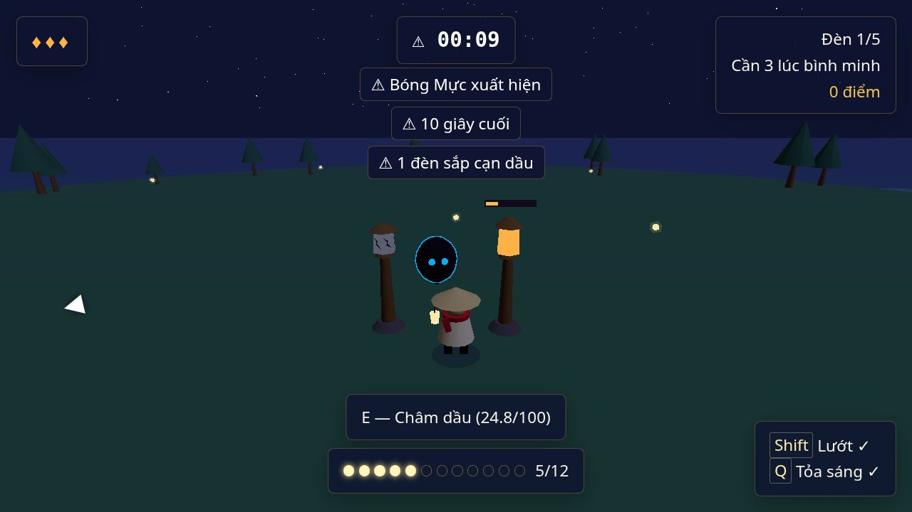

# Đảo Đèn Lồng

[Video demo MP4](docs/demo/demo.mp4) · [Bản phát hành v1.0.0](https://github.com/trinhcongduc112/K5-L3A-DAY12-TrinhCongDuc-2A202603527-AI-SDLC-Dao-Den-Long/releases/tag/v1.0.0)

Game 3D góc nhìn thứ ba. Theo chân Mây qua Đảo Bến, Đảo Cau và Đảo Chuông. Nhặt đom đóm, thắp đèn và giữ đủ đèn sáng đến bình minh.



## Cài và chơi

Cần **Node.js 20+**, npm và trình duyệt hỗ trợ **WebGL 2** trên Linux hoặc macOS. Trong thư mục repo đã clone, chạy:

```sh
npm ci
npm run build
npm start
```

Mở địa chỉ terminal in ra. Với repo đang phát triển, có thể chạy `npm run dev` sau bước cài. Bản ZIP phát hành đã build sẵn và chạy với `node scripts/run-game.js` sau khi giải nén.

| Điều khiển mặc định | Hành động |
|---|---|
| WASD hoặc phím mũi tên | Chạy |
| Kéo chuột | Xoay góc nhìn |
| Space | Nhảy |
| Shift | Lướt |
| E | Nạp đom đóm vào đèn tắt hoặc châm dầu cho đèn đang sáng |
| Q | Tỏa Sáng |
| Esc hoặc P | Tạm dừng hoặc tiếp tục |

Trong **Cài đặt**, bạn có thể đổi từng phím, hoàn nguyên, bật bảng màu dễ phân biệt, giảm chuyển động hoặc tăng cỡ chữ từ 18 lên 22,5 px. Cảnh báo hình ảnh có ở lúc Bóng Mực xuất hiện, trước khi gió thổi, trong 10 giây cuối và khi đèn yếu.

Đèn hao dầu. Dưới 30 dầu, đèn nhấp nháy, mất vùng an toàn và có thể bị Bóng Mực hút dầu. Đèn tắt cần 10 đom đóm để thắp lần đầu và 5 để thắp lại. Khi bình minh, Mây cần còn Ngọn Lửa và giữ sáng ít nhất 3/5, 4/6 hoặc 5/7 đèn tùy đêm.

Nạp hoặc châm một đom đóm cho 5 điểm. Thắp lần đầu cho 100 điểm, thắp lại cho 40. Tỏa Sáng cho 5 điểm mỗi Bóng Mực trúng, hoặc 15 nếu Bóng đang hút dầu. Khi thắng, mỗi đèn còn sáng cho 50 điểm cộng phần nguyên của dầu, mỗi Ngọn Lửa còn lại cho 50 điểm. Tổng điểm chỉ cộng các đêm đã thắng.

## Bảng xếp hạng

Lưu điểm ở màn Bình Minh hoặc màn thua, dùng tên 3–12 ký tự Latin, số hoặc dấu gạch dưới. Mở **Bảng xếp hạng** từ menu chính. Bản chạy bằng Node lưu top 10 trong thư mục dữ liệu cục bộ của người dùng. Có thể đặt `DAO_DEN_LONG_DATA_DIR` để đổi vị trí dữ liệu. Bản đưa lên một host tĩnh thuần lưu điểm trong trình duyệt của origin đó.

```sh
node scripts/run-game.js --export-leaderboard out.json
```

## Kiểm thử và đo

```sh
npm test
node src/headless.js --seed 42 --night 1 --scenario tests/fixtures/phase3-dawn.json --inputs tests/fixtures/phase3-dawn-inputs.json --ticks 65 --out /tmp/dao-den-long.jsonl
node scripts/bench.js --seed 42 --duration 30 --out bench.json
npm run soak -- --seed 7 --nights 10 --out soak.json
```

Benchmark dùng bản đã build cùng Chrome hoặc Chromium. Đặt `CHROME_BIN` nếu trình duyệt nằm ngoài các vị trí thông dụng. Lệnh mở cửa sổ 1280×720 và yêu cầu Chromium tắt vsync cùng giới hạn khung hình. FPS là tốc độ khung hình do bộ đo ghi trong renderer. `peak_mem_mb` là `null` vì RSS của một trang web không tách tin cậy khỏi các tiến trình trình duyệt/GPU. Trên Linux không có màn hình, lệnh dùng Chrome headless. Có thể đặt `DAO_BENCH_HEADLESS=1` để chạy headless chủ động.

Soak lấy RSS sau lần dựng đêm đầu và sau khi kết thúc/reset đêm cuối, sau GC ở cả hai mốc. Tiến trình soak tắt JIT để giảm dao động RSS khi đo lặp. Nó chạy các seed từ seed đầu, cộng một cho mỗi đêm tiếp theo, và giữ một tiến trình. Cảnh benchmark dùng chung renderer, với trang trí sáng tạo tắt.

[Test Contract v1.3](game.contract.json) · [Bằng chứng Phase 4](docs/proof/phase-4.md) · [Changelog](CHANGELOG.md) · [Retro](docs/retro.md)

## Sáng tạo của tôi

Biển mây, sao, trăng và đom đóm lơ lửng tạo cảnh đêm. Game dùng mô hình sinh từ mã và âm nhạc nền tổng hợp riêng cho đảo. Các hiệu ứng sáng tạo ở phần hiển thị. Test tất định và các scenario chạy qua lõi chung bằng `npm test`.

[Tài liệu lab](LAB.md) · [Nguồn nội dung](CREDITS.md)
